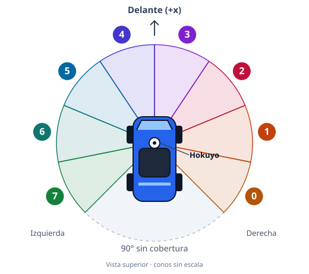

---
hide:
  - toc
---
# ROS2

## Conexión

1. Copiar `docker/.env.example` a `docker/.env` y editar `ROS_DOMAIN_ID` con el dominio elegido.
2. Usar el mismo dominio en el control y reiniciar el simulador para aplicar el cambio.

## Control

1. Publicar en **`/r0/cmd_vel`** · `geometry_msgs/msg/Twist`.

    | Campo | Significado | Unidad |
    |---|---|---|
    | `linear.x` | Velocidad longitudinal; positiva hacia delante. | m/s |
    | `angular.z` | Velocidad angular; positiva hacia la izquierda. | rad/s |

2. Límites: **100 km/h (27,78 m/s)** de velocidad y **−45° a +45°** de dirección.

## Colisiones

1. **`/r0/collision`** · `std_msgs/msg/Bool`: pasa de `false` a `true` al detectar un choque y mantiene ese valor hasta reiniciar la simulación.

## Sensores

1. Suscribirse a los topics necesarios:

    | Topic | Tipo | Información |
    |---|---|---|
    | `/r0/scan` | `sensor_msgs/msg/LaserScan` | Hokuyo: 270°, 1081 rayos, 40 Hz y alcance máximo de 30 m. |
    | `/r0/sonar0` … `/r0/sonar7` | `sensor_msgs/msg/Range` | Media de cada sector del LiDAR, a 40 Hz. |
    | `/r0/odom` | `nav_msgs/msg/Odometry` | Posición, orientación y velocidad del coche. |

## Sonares

1. Identificar los ocho sectores de **33,75°**. El ángulo cero apunta hacia delante.

| Sonar | Ángulo central |
|---|---:|
| 0 | −118,125° |
| 1 | −84,375° |
| 2 | −50,625° |
| 3 | −16,875° |
| 4 | 16,875° |
| 5 | 50,625° |
| 6 | 84,375° |
| 7 | 118,125° |

2. Leer `range`: media de las distancias válidas; `+Inf` sin retorno y `NaN` sin medida válida. Los 90° traseros quedan fuera de cobertura.
